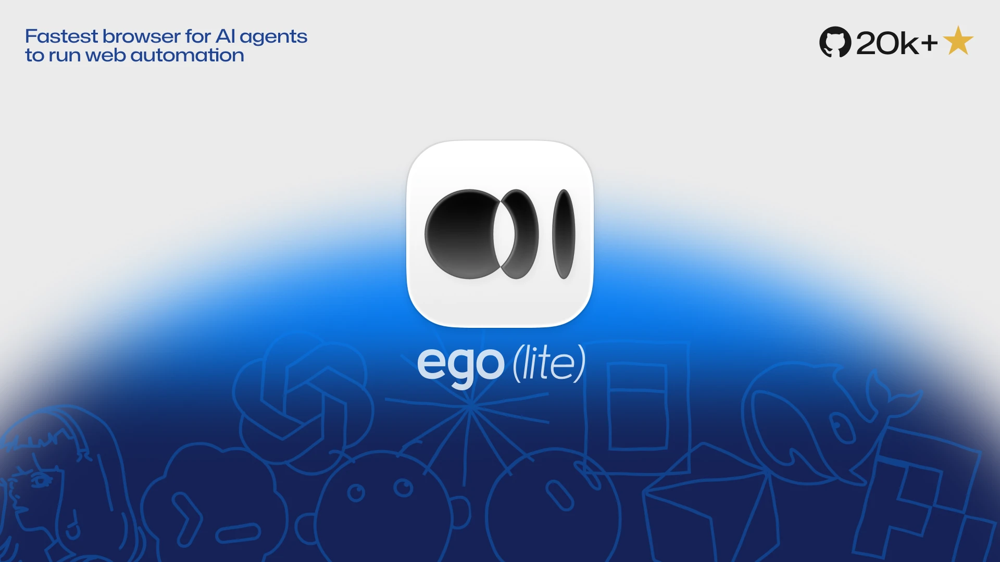
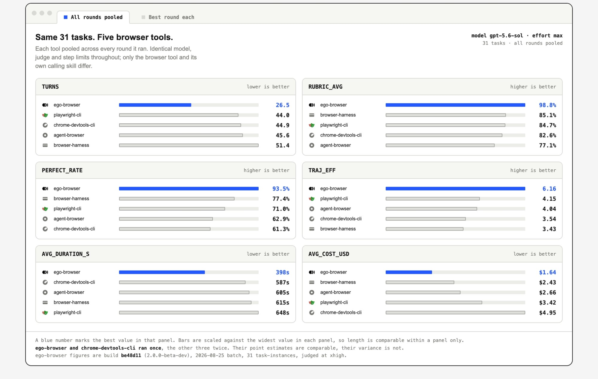

<div align="center">



**Le navigateur le plus rapide pour automatiser le web avec des agents IA**

<a href="https://trendshift.io/repositories/42334?utm_source=repository-badge&amp;utm_medium=badge&amp;utm_campaign=badge-repository-42334" target="_blank" rel="noopener noreferrer"></a>

<p>
  <a href="https://cdn.ego.app/setup/macos/arm64/egolite-Y7MbxKIuhzFB.dmg"></a>
  <a href="https://cdn.ego.app/setup/macos/x64/egolite-Y7MbxKIuhzFB.dmg"></a>
  <a href="https://cdn.ego.app/setup/windows/x64/egoliteSetup-Y7MbxKIuhzFB.exe"></a>
  <a href="https://discord.gg/5eGZVvHbTq"></a>
  <a href="https://x.com/ego_agent"></a>
  <a href="https://lite.ego.app/document/"></a>
  <a href="LICENSE"></a>
</p>

<p>
  <a href="README.md">English</a> ·
  <a href="README.zh-CN.md">简体中文</a> ·
  <a href="README.ja.md">日本語</a> ·
  <a href="README.ko.md">한국어</a> ·
  <a href="README.pt.md">Português</a> ·
  <a href="README.es.md">Español</a> ·
  <b>Français</b> ·
  <a href="README.it.md">Italiano</a> ·
  <a href="README.ru.md">Русский</a>
</p>

</div>

ego (lite) est un navigateur où vous et vos agents IA travaillez en parallèle. Vos agents exécutent leurs tâches de navigation dans leurs propres Spaces (des espaces de travail isolés dans le même navigateur) pendant que vous continuez à naviguer dans le vôtre : aucun agent ne vous prend jamais le navigateur. Et l'automatisation elle-même se termine plus vite, en consommant moins de jetons.

Les outils existants comme browser-use et agent-browser sont un pont vers le navigateur, pas un navigateur en propre : ils n'en embarquent aucun et doivent donc piloter un navigateur tiers. Vos données de navigation sont rarement reprises intactes, la connexion est instable, et vous finissez par vous disputer le contrôle du navigateur avec l'agent. ego lite est un navigateur à part entière, un seul et même navigateur pensé dès le départ pour que vous le partagiez tous les deux. Aucune configuration supplémentaire, et l'agent accède toujours à vos sessions déjà ouvertes et onglets via `ego-browser`.

## Démo

https://github.com/user-attachments/assets/ffe7954b-58ee-411e-b35d-ec30c58a08bc

## Démarrage rapide

ego lite fonctionne sur macOS et Windows, et Linux figure sur la [feuille de route](https://lite.ego.app/roadmap).

### 1. Installer

Choisissez ce qui convient le mieux à votre façon de travailler.

**1.1 Télécharger l'application**

<a href="https://cdn.ego.app/setup/macos/arm64/egolite-Y7MbxKIuhzFB.dmg"></a>
<a href="https://cdn.ego.app/setup/macos/x64/egolite-Y7MbxKIuhzFB.dmg"></a>
<a href="https://cdn.ego.app/setup/windows/x64/egoliteSetup-Y7MbxKIuhzFB.exe"></a>

Cliquez pour télécharger, puis ouvrez le fichier pour installer. Dans un cas comme dans l'autre, ego lite ajoute la Skill `ego-browser` au répertoire de Skills de chaque agent installé sur votre machine.

**1.2 Ajouter la Skill avec npx**

Installez uniquement la Skill `ego-browser` :

```bash
npx skills add citrolabs/ego-lite
```

La première fois que votre agent exécute une tâche dans le navigateur, il vous guide dans l'installation de l'application ego lite.

**1.3 Laisser votre agent s'en charger**

Collez ceci dans votre agent :

```
Configure ego lite pour moi : https://github.com/citrolabs/ego-lite

Lis `skills/ego-browser/references/install.md` et suis les étapes pour installer ego lite.
```

Au premier lancement, ego lite ne pose qu'une seule question : faut-il migrer vos données Chrome ? Répondez oui : votre agent hérite alors de vos sessions, cookies, extensions et favoris existants.

### 2. Lancer votre première tâche

Dans la CLI de votre agent, tapez `/ego-browser` suivi d'un espace, puis décrivez ce que vous voulez en langage naturel :

```
ego-browser suis @ego_agent sur x.com pour moi
```

L'agent charge la Skill `ego-browser`, ouvre la page dans son propre Space, en lit un Snapshot (la page convertie en texte structuré), agit sur la page et vous fait son rapport, sans jamais toucher à vos propres onglets.

Vos données de navigation, vos cookies et tout ce que contient le navigateur restent sur votre appareil. ego lite limite volontairement sa collecte de données : quelques signaux produit simples, comme le fait que vous ayez ou non défini ego lite comme navigateur par défaut.

## Points forts d'ego lite

| Fonctionnalité | Ce qu'elle fait |
|---|---|
| **Piloté par code, pas par CLI : des exécutions plus rapides et moins de jetons sur les tâches complexes** | Les capacités qu'ego lite expose à l'agent sont encapsulées dans des fonctions JavaScript que l'agent appelle directement. L'agent fait alors ce qu'il fait de mieux : écrire du code, et condenser une tâche en plusieurs étapes en un seul bloc de code envoyé d'un coup au lieu de s'enfermer dans une boucle « appeler deux commandes, regarder le résultat, en appeler deux autres ». Par rapport à l'approche CLI classique, les workflows complexes se terminent bien plus vite, avec un meilleur taux de réussite, beaucoup moins d'appels d'outils par tâche et un coût par tâche nettement inférieur. |
| **Un Space dédié à chaque agent** | ego lite attribue à chaque agent son propre Space, totalement isolé. Vous naviguez au premier plan, votre agent travaille en arrière-plan, sans que l'un gêne l'autre. Vous voyez à tout moment dans quel Space un agent travaille, et vous pouvez reprendre la main ou l'arrêter quand vous le souhaitez. |
| **Vos agents mènent plusieurs tâches de front dans les Spaces, des espaces de travail parallèles dans un même navigateur** | Chaque Space accueille son propre agent IA ou sa propre tâche, tous en même temps. Claude Code enrichit 10 fiches prospects dans 10 Spaces parallèles. Codex scrape 5 sites concurrents dans 5 autres. Ils ne se marchent pas dessus et ne vous prennent pas vos onglets. Votre souris reste là où vous l'avez laissée. |
| **Le Snapshot de page le plus performant du marché** | Grâce à des modifications apportées au cœur du moteur de rendu, ego lite produit les Snapshots de page de la plus haute qualité, cette description textuelle de la page sur laquelle s'appuient les modèles de langage pour « voir » une page web et agir dessus. Il gère de façon fiable les cas difficiles comme les iframes profondément imbriquées, précisément là où les autres approches échouent systématiquement. |
| **N'importe quel agent peut le piloter via `ego-browser`** | `ego-browser` est la couche de connexion entre n'importe quelle CLI d'agent (Claude Code, Codex, Cursor ou la vôtre) et ego lite. Elle expose le navigateur comme un ensemble d'outils JavaScript exécutés directement dans la page : snapshot, fill, click, wait, navigate, capture. L'agent écrit un bout de code JavaScript qui appelle ces outils, et `ego-browser` l'exécute sur la page en une seule passe. |
| **Un agent qui capitalise sur son expérience et gagne en vitesse à l'usage** *(bientôt disponible)* | L'essentiel du temps qu'un agent passe sur des tâches de navigation se perd en essais et erreurs. La Skill officielle d'ego lite transforme chaque action réussie en outils et workflows réutilisables : les tâches similaires s'exécutent ensuite jusqu'à 5× plus vite. |

## ego lite face aux produits existants

La plupart des outils savent automatiser un navigateur. Les vraies questions sont ailleurs : de quel navigateur l'agent dispose-t-il ? Pouvez-vous continuer à travailler pendant ce temps ? L'outil est-il conçu pour l'agent que vous utilisez déjà, ou pour un agent intégré ?

| Fonctionnalité | ego lite | Extensions de navigateur<br><sub>Claude/Codex in Chrome</sub> | Navigateurs intégrés<br><sub>Navigateur intégré de Claude/ChatGPT</sub> | Navigateurs cloud<br><sub>Browserbase/Browser Use</sub> | CLI de navigateur<br><sub>playwright-cli/Browser Harness</sub> | Navigateurs IA<br><sub>Comet/Dia</sub> |
|---|:---:|:---:|:---:|:---:|:---:|:---:|
| Compatible avec tout agent IA | ✓ | — | — | ✓ | ✓ | — |
| Réutilise vos sessions de navigateur | ✓ | ✓ | — | — | — | ✓ |
| Moins de CAPTCHA | ✓ | ✓ | — | — | — | ✓ |
| Agit sur tout votre ordinateur | ✓ | — | ✓ | — | ✓ | — |
| Ne détourne pas votre navigateur | ✓ | — | ✓ | ✓ | — | — |
| Multitâche en parallèle | ✓ | — | — | ✓ | — | — |
| Gère le scraping à grande échelle | ✓ | — | — | ✓ | ✓ | — |
| Sert de navigateur au quotidien | ✓ | ✓ | — | — | — | ✓ |
| Gratuit | ✓ | — | — | — | ✓ | — |
| Données stockées en local | ✓ | ✓ | ✓ | — | ✓ | — |
| Compétences réutilisables (bientôt disponible) | ✓ | — | — | — | — | — |

## Benchmarks

Plus rapide, taux de réussite plus élevé, moins de jetons. Nous avons comparé ego-browser à quatre autres outils de navigateur pour agents IA sur Real-World Bench : 31 tâches complexes d'automatisation web sur de vrais sites en ligne. ego-browser arrive en tête pour la vitesse, le taux de réussite et le coût, et fait aboutir les tâches web complexes de votre agent de 47 % à 63 % plus vite que les autres outils.

<div align="center">



</div>

Chaque outil a exécuté les mêmes 31 tâches, piloté par le même agent (pi) avec le même modèle (gpt-5.6-sol, effort de réflexion max), et a été noté par le même juge selon une grille propre à chaque tâche. Une tâche ne compte comme une réussite complète que si toutes ses exigences sont remplies.

## Documentation

Les tutoriels, la référence complète des outils et les guides d'intégration se trouvent sur [lite.ego.app/document/](https://lite.ego.app/document/).

## Communauté

- [Discord](https://discord.gg/5eGZVvHbTq), questions, aide à la configuration et partage de Skills
- [GitHub Discussions](https://github.com/citrolabs/ego-lite/discussions), idées et discussions de fond
- [X/Twitter](https://x.com/ego_agent), nouveautés et versions

## Historique des stars

<a href="https://github.com/citrolabs/ego-lite/stargazers">
<!-- star-history:start -->
<!-- Generated daily by .github/workflows/star-history.yml and published to the
     'star-history' branch, because main's ruleset will not take a bot commit. -->
<picture>
  <source media="(prefers-color-scheme: dark)" srcset="https://raw.githubusercontent.com/citrolabs/ego-lite/star-history/star-history-dark.svg">
  
</picture>
<!-- star-history:end -->
</a>

## Licence

Le contenu de ce dépôt est publié sous [licence MIT](LICENSE). Le navigateur ego lite se télécharge à part, gratuitement.
